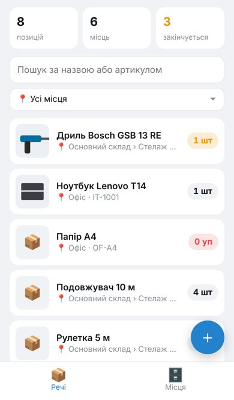
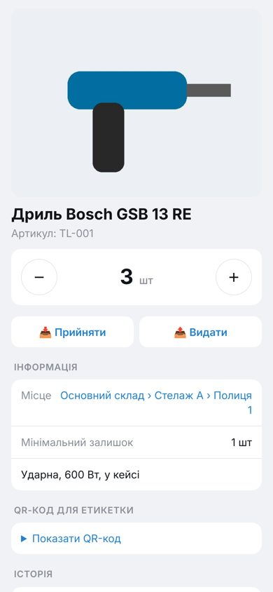
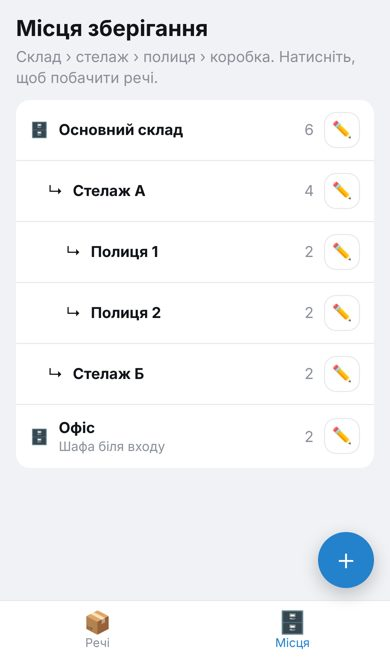
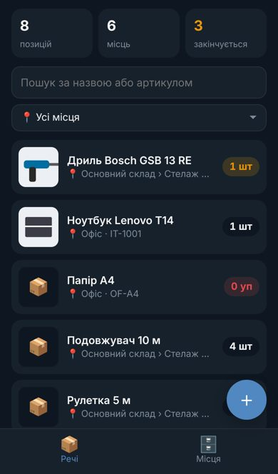

# 📦 Склад — облік речей у Telegram

Telegram-бот + **Mini App** (застосунок усередині Telegram) для складського обліку:
що є на складі, скільки, де саме лежить, як називається і як виглядає.

<p>




</p>

## Можливості

**Mini App (відкривається кнопкою в боті):**
- 🔎 Пошук за назвою, артикулом або описом (без урахування регістру, з кирилицею)
- 📍 Вкладені місця зберігання: *Склад › Стелаж А › Полиця 2*. Фільтр за місцем показує й усе, що лежить у вкладених
- 📷 Фото кожної речі (стискається автоматично, з мініатюрами)
- ➕➖ Швидка зміна кількості, «Прийняти» / «Видати» з коментарем (кому видано)
- ⚠️ Мінімальний залишок: речі, що закінчуються, підсвічуються
- 🕓 Історія змін по кожній речі: хто, коли і що змінив
- 🏷 QR-коди для етикеток на речі та полиці. Сканер вбудовано в Telegram (кнопка ⌗)
- 🌗 Світла й темна теми підлаштовуються під Telegram

**Бот:**
- Напишіть будь-який текст, і бот знайде річ (з фото, кількістю й місцем)
- Надішліть **фото з підписом** `Назва | кількість | місце`, і річ додасться
- `/low`: що закінчується; `/stats`: статистика
- Доступ за ролями: **viewer** (перегляд), **editor** (зміни), **admin** (керує користувачами)
- Новий користувач натискає /start, і адміністратор отримує запит з кнопками «Перегляд / Редагування»

## Аналіз схожих проєктів

| Проєкт | Що це | Чому не взяли як є |
|---|---|---|
| [Homebox](https://github.com/sysadminsmedia/homebox) | Домашній інвентар: місця, мітки, QR, гарантії | Окремий веб-сайт, немає Telegram |
| [InvenTree](https://inventree.org) | Потужна система обліку деталей і запасів (Django) | Складна для простого складу, важка у розгортанні |
| [Grocy](https://grocy.info) | Облік продуктів і побутових запасів | Заточена під кухню й терміни придатності |
| Telegram-боти на Google Sheets | Команди `/stock`, `/adjust` | Немає фото, місць і зручного інтерфейсу |

**Що взяли:** вкладені місця і QR-етикетки (Homebox), журнал руху з поточним залишком (InvenTree),
мінімальний залишок (Grocy). **Чим відрізняється:** усе в Telegram, нічого встановлювати не треба,
а вхід автоматичний через підписаний Telegram `initData`, без паролів.

## Архітектура

```
Telegram ──► Бот (aiogram 3) ─┐
                              ├──► services.py ──► SQLite (data/warehouse.db)
Mini App ──► FastAPI /api ────┘                    Фото   (data/media/)
(webapp/: HTML+JS без збірки)
```

- **Один процес**: FastAPI віддає Mini App і API, бот працює поруч (long polling)
- **Безпека**: кожен запит Mini App несе `initData`, підписаний Telegram. Сервер перевіряє HMAC-підпис
  ключем бота ([документація](https://core.telegram.org/bots/webapps#validating-data-received-via-the-mini-app))
- **SQLite**: один файл, бекап робиться звичайним копіюванням папки `data/`

```
app/
  config.py    налаштування з .env
  models.py    таблиці: users, locations, items, movements
  auth.py      перевірка Telegram initData
  services.py  бізнес-логіка (спільна для бота й API)
  api.py       REST API для Mini App
  bot.py       Telegram-бот
  main.py      запуск усього разом
  seed.py      демо-дані
webapp/        Mini App (index.html, app.js, style.css)
tests/         тести (pytest)
```

## Запуск

### 1. Створіть бота
1. У Telegram відкрийте [@BotFather](https://t.me/BotFather), надішліть `/newbot` і скопіюйте **токен**
2. Дізнайтеся свій Telegram ID у [@userinfobot](https://t.me/userinfobot)

### 2. Налаштуйте
```bash
cd warehouse
cp .env.example .env
# впишіть BOT_TOKEN, ADMIN_IDS і WEBAPP_URL
```

### 3. Mini App потребує HTTPS-адреси
Telegram відкриває Mini App лише за `https://`. Варіанти:

**Для тесту на ноутбуці** через безкоштовний тунель [cloudflared](https://developers.cloudflare.com/cloudflare-one/connections/connect-networks/downloads/):
```bash
cloudflared tunnel --url http://localhost:8000
# скопіюйте https://xxxx.trycloudflare.com у WEBAPP_URL в .env
```

**Постійно**: VPS з Docker і доменом (HTTPS через Caddy або nginx + Let's Encrypt).

### 4. Запустіть

**Docker:**
```bash
docker compose up -d --build
```

**Без Docker** (Python 3.11+):
```bash
python -m venv .venv && source .venv/bin/activate   # Windows: .venv\Scripts\activate
pip install -r requirements.txt
python -m app.seed            # необов'язково: демо-дані
uvicorn app.main:app --port 8000
```

Відкрийте бота в Telegram, натисніть **/start** і кнопку **«📦 Відкрити склад»** (або кнопку «Склад» біля поля вводу).

### 5. (Необов'язково) QR-коди відкривають застосунок з камери телефона
У @BotFather: `/mybots` → ваш бот → **Bot Settings → Configure Mini App → Enable Mini App**
і вкажіть той самий `WEBAPP_URL`. Тоді посилання `https://t.me/<бот>?startapp=item_5` відкриває
картку речі одразу в Telegram.

## Розробка без Telegram

```bash
DEV_MODE=1 RUN_BOT=0 ADMIN_IDS=1 uvicorn app.main:app --reload
# відкрийте http://localhost:8000 у браузері
```
⚠️ `DEV_MODE=1` вимикає перевірку доступу, тому **ніколи** не вмикайте його на сервері.

Тести:
```bash
pip install -r requirements-dev.txt
pytest
```

## Керування доступом

- Адміністратори задаються в `ADMIN_IDS` (через кому)
- Новий користувач пише боту /start, і адміну приходить запит з кнопками
- Або вручну: `/allow 123456789 editor`, `/deny 123456789`, `/users`

## Обмеження та ідеї на майбутнє

- Фото доступні за випадковим посиланням (`/media/<uuid>.jpg`) без авторизації, бо тег ``
  не передає заголовки. Посилання неможливо вгадати, але ним можна поділитися
- Можна додати: експорт в Excel, друк аркуша етикеток, кілька складів з окремими правами,
  нагадування в бот про залишки, сканування штрихкодів товарів
